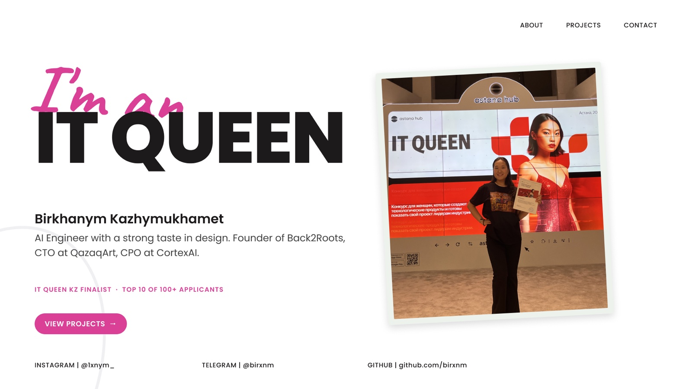
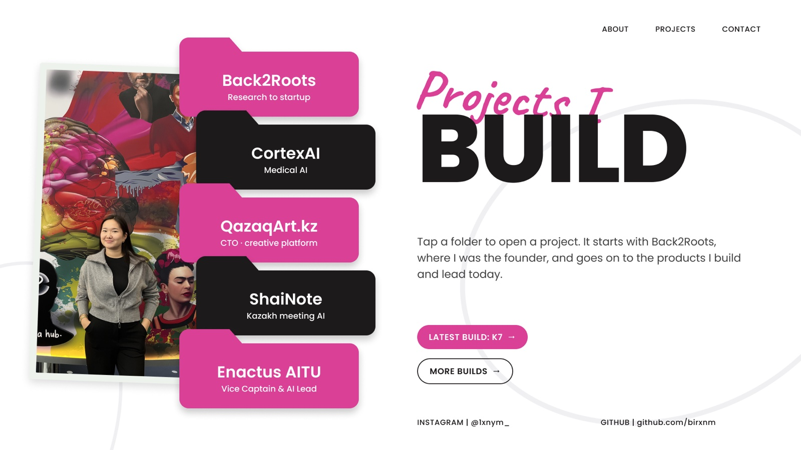

<div align="center">

<a href="https://birkhanym-portfolio.vercel.app">
  
</a>

# ✨ I'm an IT Queen ✨

**Birkhanym Kazhymukhamet** · AI Engineer with a strong taste in design 💅

*Founder of Back2Roots · CTO at QazaqArt · CPO at CortexAI*

[](https://birkhanym-portfolio.vercel.app)


</div>

---

## 💌 What is this?

This is my personal portfolio: one scrolling page about **the projects I build and lead**, from a robotics
research lab to medical AI, a creative platform for Kazakh artists, and a 24-hour hackathon app.

It's also my **application to Higgsfield Soul Camp** 🏕️ (Almaty · November 21–22 · Tech track).
Instead of a PDF, here's the real thing: a site I designed in Figma and built myself.

> *Let's build something beautiful together.* 🎀

---

## 🗂️ The projects inside



| | Project | What it is | My role | Highlight |
|---|---|---|---|---|
| 🤖 | **Back2Roots** | Kazakh-speaking AI city-guide avatar, born in a robotics lab | Founder & full-stack dev | 🥈 2nd of 1,800 teams at Meta Llama Accelerator |
| 🩺 | **CortexAI** | AI that predicts kidney transplant rejection | CPO & AI Engineer | 🌍 Top 4 · Enactus World Cup 2025 |
| 🎨 | **QazaqArt.kz** | Platform helping Kazakh artists build sustainable businesses | CTO & IT Lead | 🇺🇳 Partnerships with the British Council & UN |
| 🎙️ | **ShaiNote** | AI that transcribes & summarises meetings in Kazakh | Software Engineering Intern | ✨ 1 of 11 selected from 350+ |
| 🏆 | **Enactus AITU** | Student social-entrepreneurship team | Vice Captain & AI Lead | 🥇 National Champions ×2 |
| 🥷 | **K7** | Quest app for meeting people through shared interests | Latest build | ⚡ Built in 24h at Business Cup 2.0 |

**➕ And also:** HackAlem AI (wind-power forecasting agent) · ForteBank Datathon 26 · an IEEE paper on
LEO satellite routing · *Birka's Journey* reels 🎬

---

## 🎀 The vibe

- 💗 **One long scroll**, in the same order as my Figma slides
- 📸 **Polaroid photos** that straighten and lift when you hover
- 🌫️ **Fade-in animations** as each section scrolls into view
- 📁 **Folder tabs** that jump straight to each project
- 📱 **Phone-friendly**, with no sideways scrolling

---

## 🛠️ Run it locally

```bash
npm install
npm run dev      # → http://localhost:5173
npm run build    # production build in dist/
```

### 🧭 Where things live

```
src/
├── data/site.js     ← all text, links and photo names (edit here!)
├── sections/        ← Hero, Projects, each project, More builds, Contact
├── components/      ← Nav, Polaroid (Pic), Collage, Folder, Button, Reveal
└── index.css        ← colours, fonts, animations
public/images/       ← photos exported from Figma
```

Every push to `main` redeploys the site on Vercel automatically 🚀

---

<div align="center">

## 📬 Say hi

[](https://instagram.com/1xnym_)
[](https://t.me/birxnm)
[](https://github.com/birxnm)
[](mailto:k.birkhanym@gmail.com)

*designed in Figma, built with 💗 in Kazakhstan*

</div>
